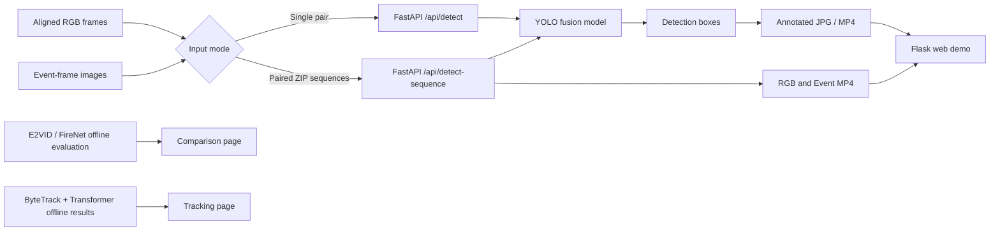

# Hybrid Vision: RGB–Event Drone Detection

<p align="center">
  <strong>RGB–Event Fusion · Event Reconstruction · Drone Tracking & Trajectory Prediction · Interactive Web Demo</strong><br>
  Technical University of Munich (TUM) · Applied Machine Intelligence · Summer Semester 2026 · Group 02
</p>

<p align="center">
  <a href="#overview">Overview</a> ·
  <a href="#methods">Methods</a> ·
  <a href="#results">Results</a> ·
  <a href="#web-demo">Web Demo</a> ·
  <a href="#quick-start">Quick Start</a> ·
  <a href="#repository-structure">Code</a>
</p>

## Overview

**Hybrid Vision** is an end-to-end course project exploring **drone detection from synchronized RGB images and event-camera representations** using the [FRED (Florence RGB-Event Drone) dataset](https://github.com/miccunifi/FRED). It combines a study of three YOLO-based RGB–Event fusion approaches with event-only reconstruction baselines, a tracking/trajectory-prediction module, and a browser-based demonstration.

The demo lets users select a fusion model, submit either a synchronized **single image pair** or a **pair of ZIP archives of image frames**, and inspect detections. In sequence mode, the backend produces RGB-input, Event-input and annotated-output MP4 files for synchronized playback in the website. The site also includes offline reconstruction comparisons and a tracking showcase page.

> **Scope:** The sequence workflow accepts paired **frame ZIPs**, not direct MP4 uploads or raw event streams. The Tracking page is a **precomputed showcase**; real-time tracking is **not** connected to the detection API.

<!-- Add a real screenshot/GIF after committing it to this path:
<p align="center"></p>
-->

## Project at a glance

| Component | What the code implements |
| --- | --- |
| **RGB–Event fusion** | Early fusion, two-stream-lite fusion and late fusion detection using YOLO-based models. |
| **Single-frame inference** | Upload an aligned RGB image and Event-frame image; display boxes, classes, confidence and the annotated RGB image. |
| **Frame-sequence inference** | Upload RGB/Event frame ZIP files; run frame-by-frame detection; encode three playable MP4 videos. |
| **Web application** | Home, Detection, Comparison and Tracking routes; synchronized playback controls and speed selection. |
| **Event-only baselines** | Offline E2VID and FireNet reconstruction and detection evaluation; comparison statistics and sample images. |
| **Tracking research** | ByteTrack-based association and Transformer-based future-box prediction; separate scripts and recorded results. |

### System architecture



## Methods

| Method | Approach | Implementation |
| --- | --- | --- |
| **Two-Stream-Lite** (default) | Separate RGB/Event stems followed by feature fusion before the YOLO backbone. | [`train/two_stream_lite/`](train/two_stream_lite/) |
| **Early Fusion** | Concatenate RGB and Event-frame channels as a 6-channel tensor; adapt the YOLO input stage. | [`train/early_fusion/`](train/early_fusion/) |
| **Late Fusion** | Run RGB-only and Event-only YOLO detectors, then combine bounding boxes with NMS-style fusion. | [`train/late_fusion/`](train/late_fusion/) |
| **Event reconstruction** | Reconstruct intensity images from event data with E2VID and FireNet, then evaluate a detector offline. | [`Event_only_reconstruction/`](Event_only_reconstruction/) |
| **Tracking and forecasting** | Associate detections with ByteTrack, then forecast future bounding boxes with an event-aware Transformer. | [`trackpre/`](trackpre/) |

## Results

The project's **Comparison page** includes the following reported detection metrics (the values currently appear as a static HTML table in [`Comparison.html`](HybridVision_Web/templates/Comparison.html)). They are **not computed on demand by the comparison API**. For detailed experiments, consult the module READMEs and [final report](docs/ami_report.pdf).

| Approach | Precision | Recall | mAP@0.5 | mAP@0.5:0.95 |
| --- | ---: | ---: | ---: | ---: |
| **Two-Stream-Lite Fusion** | **82.72%** | **78.74%** | **78.59%** | **36.48%** |
| Early Fusion | 81.58% | 78.72% | 77.70% | 36.13% |
| Late Fusion | 40.72% | 64.78% | 50.57% | — |
| FireNet reconstruction + detection | 22.10% | 7.97% | 3.63% | 0.85% |
| E2VID reconstruction + detection | 0.04% | 0.53% | 0.0004% | 0.0002% |

**Interpretation:** Two-Stream-Lite achieves the highest *reported* mAP@0.5 among the listed approaches. The reconstruction baselines are evaluated under a different input/reconstruction pipeline; consult the [reconstruction metrics note](Event_only_reconstruction/results_summary/reconstruction_eval_metrics.md) before making controlled comparisons. For Two-Stream-Lite and Early Fusion, their training READMEs document the selected checkpoint results at greater precision.

The **dynamic part** of the Comparison page calls `GET /api/compare` and reads the precomputed E2VID/FireNet CSV. It displays counts of reconstructed frames, frames with detection outputs, **detection coverage**, and sample detection images. *Detection coverage is not mAP, precision or recall.*

<!-- Recommended paired qualitative visualization once real outputs are added:

-->

## Web demo

| Page | Address | Features |
| --- | --- | --- |
| **Home** | `http://localhost:8888/` | Introduction, pipeline and entry to detection. |
| **Detection** | `http://localhost:8888/detection` | Single-image or frame-sequence mode; three fusion methods; detection overlays; synchronized triple-video playback for sequence mode. |
| **Comparison** | `http://localhost:8888/comparison` | Reported static metrics table and dynamically fetched offline E2VID/FireNet statistics and image gallery. |
| **Tracking** | `http://localhost:8888/tracking` | Informational page with embedded precomputed tracking video and downloads **when those static files are supplied**. |

### Detection modes

**Single image pair:** Upload a matching RGB image and rendered Event-frame image; choose `two_fusion`, `early_fusion` or `late_fusion`, set confidence (default `0.25`), and select **Run Detection**. The app displays input previews, an annotated output, classes, confidence, detection sources and bounding-box coordinates.

**Frame-sequence ZIP:** Select `Frame sequence zip`, upload an RGB ZIP and an Event ZIP, choose the model, FPS (default `30`, valid 1–120), and maximum frames (default `300`, valid 1–3000). After processing, watch synchronized **RGB Input / Event Input / Detection Output** MP4 playback. Controls include **Play All, Pause All, Restart**, speed (`0.5×`, `1×`, `1.5×`, `2×`) and synchronized seeking.

Paired ZIPs should each contain image frames with equivalent **natural-sort ordering** (e.g., `000001.png`, `000002.png`, ...). The backend pairs sorted files by position, **not** timestamp or matching filename, and processes up to the shorter sequence or `max_frames`. Ensure data are aligned before uploading. Raw `.aedat`, `.h5` and MP4 inputs are **not** supported by these APIs.

## Quick start

### 0. Prerequisites and missing artifacts

You need **Docker + Docker Compose**, **Python 3**, and **Flask** for the separate frontend. The Docker service is configured for **CPU inference** (`INFERENCE_DEVICE=cpu`); large batches or long sequences can take substantial time.

**Important: the current public `main` tree does not include `backend_service/models/` or `backend_service/test_assets/`.** The Dockerfile contains `COPY models ./models`, so `docker compose build` will **fail until the `models` directory exists**. Obtain the trained checkpoints from the project maintainers and put them at:

```text
backend_service/models/
├── early_fusion_best.pt
├── two_fusion_best.pt
├── late_fusion_rgb_best.pt
└── late_fusion_event_best.pt
```

For only one fusion method, you may have fewer weights available, but `models/` must exist to satisfy the current Dockerfile and the requested method needs its corresponding weights. Model loading is lazy. The reference dataset, full training outputs and some demo media also are not bundled in this public repository.

### 1. Clone and start the FastAPI backend

```bash
git clone https://github.com/KRb-1/Hybrid_Vision.git
cd Hybrid_Vision/backend_service
# First put the required checkpoints into models/ (see above).
docker compose up -d --build
```

Verify that the service responds and that your selected weights are available:

- [API health](http://localhost:8000/api/health) — `GET /api/health`; `status: ok` alone does not prove all models can run.
- [Swagger UI](http://localhost:8000/docs) — inspect/test endpoints.

### 2. Start the Flask frontend (separate terminal)

From the repository root:

```bash
cd HybridVision_Web
python -m pip install flask
python app.py
```

Open **http://localhost:8888**. The JavaScript in the browser connects to `http://localhost:8000`, so these local URLs assume the browser and API are running on the same computer. For remote deployment, update the `BACKEND_URL` values in the frontend scripts.

### 3. Stop services

Stop Flask with `Ctrl+C`. From `backend_service/`, run:

```bash
docker compose down
```

**Note:** Docker Compose currently containerizes **only the FastAPI backend**. Starting the web interface requires the separate Flask command above; there is no root-level single-command full-stack Compose deployment.

## API summary

| HTTP | Path | Purpose |
| --- | --- | --- |
| `GET` | `/api/health` | Device configuration, loaded models and available checkpoint files. |
| `POST` | `/api/detect` | One synchronized RGB/Event image pair to image + detection JSON. |
| `POST` | `/api/detect-sequence` | Two ZIP archives of frame images to three MP4s + per-frame detections. |
| `GET` or `POST` | `/api/compare` | Offline reconstruction statistics and sample-image links. |

The `POST /api/detect` form uses `rgb_file`, `event_file`, `method`, optional `confidence`, and `use_tracking=false`. The `POST /api/detect-sequence` form uses `rgb_zip`, `event_zip`, `method`, optional `confidence`, `fps`, and `max_frames`. Both endpoints accept `two_fusion`, `early_fusion` or `late_fusion`.

The backend serves generated media at `/results/...`; Team B's sample images are available via `/team-b-samples/...`. There is **no** `/api/detect-video` or online tracking endpoint in the current code.

For request examples and detailed field behavior, see the [Backend README](backend_service/README_BACKEND.md) and [API contract](backend_service/docs/API_HANDOFF.md).

## Repository structure

```text
Hybrid_Vision/
├── train/
│   ├── early_fusion/              # Six-channel input fusion: preprocessing, train, evaluation
│   ├── two_stream_lite/           # Custom RGBEventStem, training, prediction, evaluation
│   └── late_fusion/              # Separate detectors and NMS prediction fusion
├── Event_only_reconstruction/     # E2VID / FireNet offline reconstruction evaluation
├── trackpre/                      # ByteTrack + Transformer trajectory forecasting
├── backend_service/              # FastAPI inference, media rendering, Docker Compose
├── HybridVision_Web/             # Flask HTML/CSS/JS demo: four pages
└── docs/                         # Final slides and project report (PDF)
```

| Directory | Details |
| --- | --- |
| [`train/early_fusion/`](train/early_fusion/) | TIFF dataset builder, NaN-safe training, validation, visualization; [instructions](train/early_fusion/README_early_fusion_en.md). |
| [`train/two_stream_lite/`](train/two_stream_lite/) | `RGBEventStem` and Ultralytics patch, training scripts, evaluation; [instructions](train/two_stream_lite/README_two_stream_lite_en.md). |
| [`train/late_fusion/`](train/late_fusion/) | RGB/Event detector training, NMS-style fusion and mAP evaluation; [instructions](train/late_fusion/Train_Fuse_README.md). |
| [`Event_only_reconstruction/`](Event_only_reconstruction/) | Event-stream conversion scripts, evaluation summaries, E2VID/FireNet detection images; [instructions](Event_only_reconstruction/README_memberB_reconstruction.md). |
| [`trackpre/`](trackpre/) | Tracking/prediction scripts and saved text results; [instructions](trackpre/README.md). |
| [`backend_service/`](backend_service/) | FastAPI routes, model registry, inference, ZIP/frame handling, video encoding, baseline statistics; [instructions](backend_service/README_BACKEND.md). |
| [`HybridVision_Web/`](HybridVision_Web/) | Flask entry point, four page templates and browser logic; [instructions](HybridVision_Web/README_HybridVision_Web.md). |
| [`docs/`](docs/) | [Final presentation](docs/Hybrid_Vision_final_slide.pdf) and [report](docs/ami_report.pdf). |

The repository snapshot **does not contain** the previously documented `train/results/` directory or `event-only_reconstruction/` placeholder. References to older workspace names such as `ami_two_fusion` in module READMEs refer to their original development environments, not paths in this public repository.

## Project resources

- [Project report](docs/ami_report.pdf) · [Final slides](docs/Hybrid_Vision_final_slide.pdf)
- [FRED dataset](https://github.com/miccunifi/FRED) — please follow its dataset terms and obtain the source data separately.
- [Web guide](HybridVision_Web/README_HybridVision_Web.md) · [Backend guide](backend_service/README_BACKEND.md)

---

**TUM · Applied Machine Intelligence · Group 02 · Summer Semester 2026**
